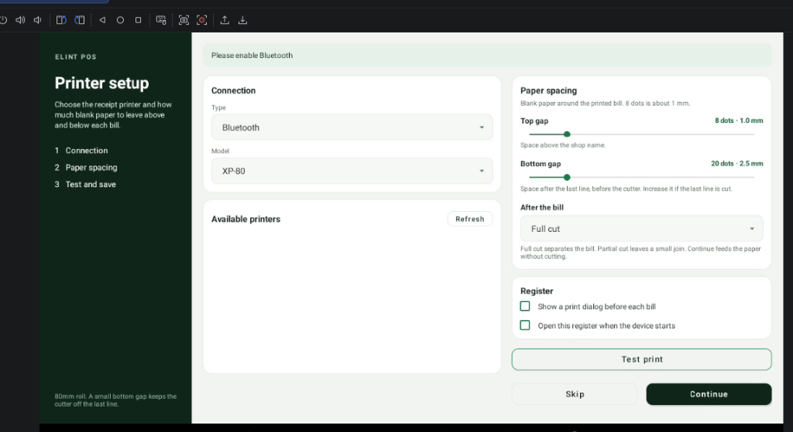
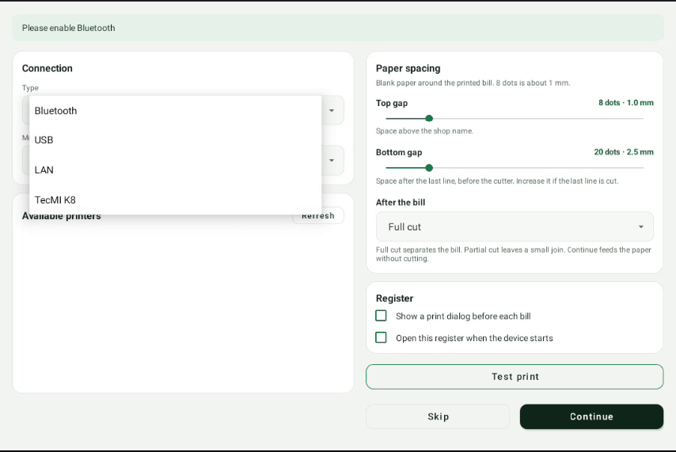
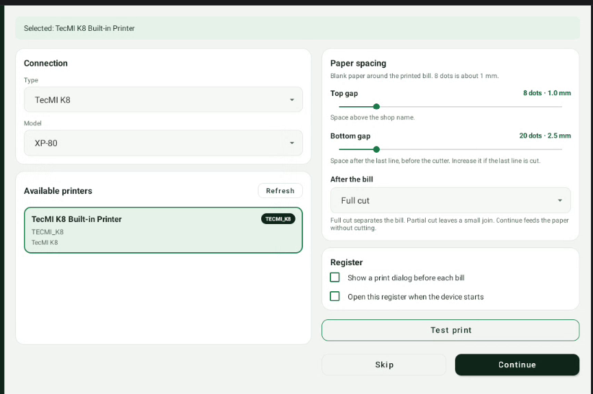
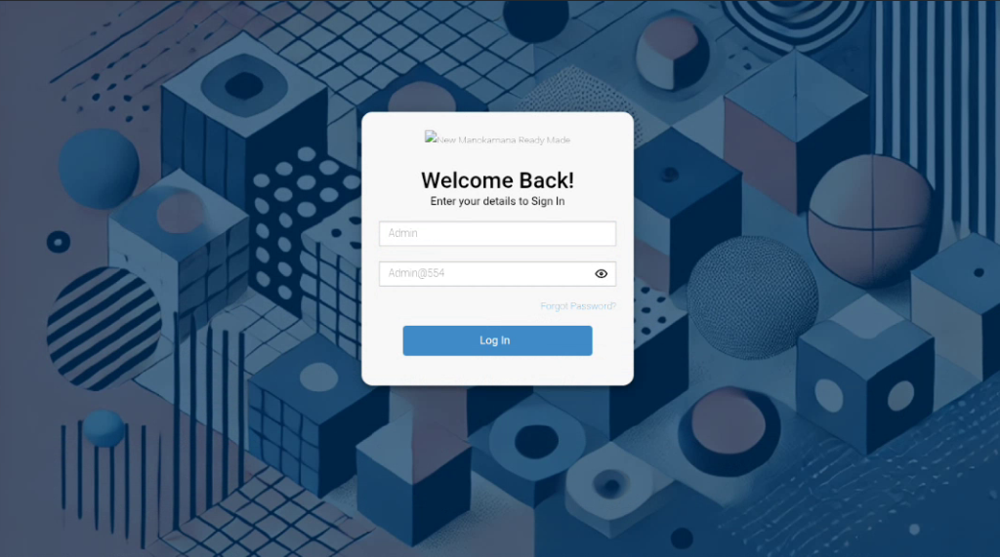

# ElintPOS Android App – Setup & Login User Guide

This user guide walks you through the step-by-step process of configuring your receipt printer and logging into the **ElintPOS Android App** upon initial boot.

---

## Step 1: App Boot & Initial Printer Setup Screen

When you install and launch the app for the first time (or after clearing app storage), the system automatically directs you to the **Printer Setup** screen.

### Key Sections on this Screen:
1. **Connection Box:** Allows you to choose the printer connection type (Bluetooth, USB, LAN, TecMI K8) and printer model.
2. **Available Printers Box:** Displays discovered or paired printers ready to connect.
3. **Paper Spacing:** Adjust blank margin above (**Top gap**) and below (**Bottom gap**) the bill (Default: Top 8 dots / Bottom 20 dots).
4. **After the bill:** Choose cutter mode (`Full cut`, `Partial cut`, or `Continue`).
5. **Register Options:**
   - *Show a print dialog before each bill* (prompts before printing each receipt).
   - *Open this register when the device starts* (launches the app automatically on device startup).

---

## Step 2: Select Connection Type & Printer Model

Tap the **Type** dropdown inside the **Connection** card and select your printer's connection interface:

### Supported Connection Types:
- **Bluetooth:** For wireless mobile thermal printers (58mm / 80mm).
  > **Note:** Ensure Bluetooth is turned **ON** on your Android device and the printer is paired.
- **USB:** For printers connected directly via USB cable or OTG adapter.
- **LAN:** For network thermal printers connected over Wi-Fi / Ethernet (Port 9100).
- **TecMI K8:** For all-in-one POS terminals with built-in thermal printers.

Select the corresponding model from the **Model** dropdown (e.g., `XP-80` for 80mm paper rolls).

---

## Step 3: Available Printer Selection, Test Print & Continue

Once the connection type is selected, your printer will be detected and listed under **Available printers**:

### Actions to Perform:
1. **Select Printer:** Tap the printer item in the list (e.g., **TecMI K8 Built-in Printer** or your paired Bluetooth/USB device). A green highlight confirms selection.
2. **Test print:** Tap the **Test print** button. Ensure the printer prints the test receipt properly.
3. **Continue:** Click the green **Continue** button in the bottom right corner.

> **Important (Permanent Persistence):** Clicking **Continue** permanently saves this configuration into Android SharedPreferences. This setup screen will automatically be skipped on future app launches, unless the app is uninstalled or storage data is cleared.

---

## Step 4: POS Login Screen & Start Billing

Once printer setup is complete, the app automatically transitions to the **ElintPOS Sign In** screen:

### Sign In Steps:
1. **Username:** Enter your POS username (e.g., `Admin`).
2. **Password:** Enter your password (e.g., `Admin@554`).
3. **Log In:** Tap the blue **Log In** button.

Upon successful authentication, the main **POS Billing Dashboard** will load, and your Android register is fully primed for high-speed automated receipt printing!
